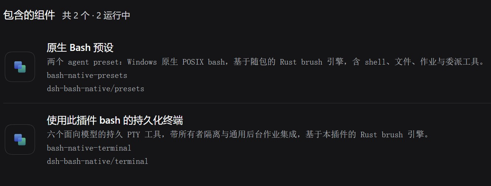

<!-- ═══════════════════════════════════════════════════════════════════════ -->

<div align="center">

# 🐚 dsh-bash-native

### A native POSIX bash on Windows, written in Rust

**Give DSH's shell a genuinely native `bash`** — the rubash engine, with no WSL and no MSYS compatibility layer

<br>

`Follows the three-tier file policy` · `Background jobs` · `Persistent terminals`

<br>

[](https://dsh-plugin.org/zh/plugins/spookywaste/dsh-bash-native)
[](https://www.npmjs.com/package/dsh-bash-native)
[](https://www.npmjs.com/package/dsh-bash-native)
[](https://github.com/deepseek-ai/deepseek-harness)
[](https://github.com/unixwin/rubash)

[**中文**](README.md) &nbsp;·&nbsp; **English**

</div>

---

## 🐟 Why it exists

> ~~So the fat fish stops getting bitten by cmd~~, and without the performance cost of a subsystem or an MSYS layer

<p align="center">
  
</p>

<table align="center">
  <thead>
    <tr>
      <th align="left">Approach</th>
      <th align="left">Where the command runs</th>
      <th align="left">Cost per command</th>
    </tr>
  </thead>
  <tbody>
    <tr>
      <td><b>Git for Windows</b></td>
      <td>A bash ported onto the MSYS2 layer; POSIX semantics are emulated by the runtime</td>
      <td>Every subshell or external command forks a whole MSYS2 process (suspend threads, spawn a process, shovel memory through a pipe), and the cost grows with how often subshells start</td>
    </tr>
    <tr>
      <td><b>WSL</b></td>
      <td>The command runs in a Linux distribution inside a VM</td>
      <td>Every command crosses the Windows/Linux boundary twice; the latency hurts most on many short commands</td>
    </tr>
    <tr>
      <td><b>This plugin</b><br><sub>rubash engine + toolchain</sub></td>
      <td>Native binaries written in Rust, with no emulation layer and no VM</td>
      <td><code>grep</code>, <code>sed</code>, <code>awk</code> and friends come from the bundled toolchain; the rest runs in the engine's own process, with no compatibility layer or VM boundary</td>
    </tr>
  </tbody>
</table>

---

## 📦 Install

### From the CLI

```
dsh plugin --profile web add dsh-bash-native
```

### From the dsh web or desktop app

> **dsh plugins page** → **Add plugin** (top right) → enter the name `dsh-bash-native` or the repository URL:

```
https://github.com/SpookyWaste/dsh-bash-native
```

After a restart, set **Native Bash (Windows)** as the default preset under **Settings → General** (or switch to it inside a session).

> The persistent-terminal component is **off by default**; turn it on in the plugin manager. See [the persistent-terminal component](#-persistent-terminal-component).

<table>
  <tbody>
    <tr>
      <td><b>Platform</b></td>
      <td>Windows x64</td>
    </tr>
    <tr>
      <td><b>DSH</b></td>
      <td><code>&gt;=0.2.0-rc.2 &lt;0.3.0-0</code> (0.2.0-rc.2 - 0.2.1-alpha.5)</td>
    </tr>
    <tr>
      <td><b>Persistent-terminal component</b></td>
      <td>Needs DSH <code>&gt;=0.2.1-alpha.1</code> to be enabled</td>
    </tr>
  </tbody>
</table>

---

## ⚙️ Engine

The engine is **rubash** ([`unixwin/rubash`](https://github.com/unixwin/rubash), a bash-5.3-compatible shell written in Rust, MIT). This repository builds it from source, applies three patches at the commit pinned in `engine.lock.json`, and ships the result as `engine/win32-x64/rubash.exe` (about 11 MB).

It reports a GNU bash 5.3 banner and an **MSYS-compatible `uname -s`** (`MSYS_NT-…`), so scripts that branch on MSYS keep working; concurrency, cancellation and job semantics are the engine's own and depend on no MSYS runtime.

<details>
<summary><b>🧩 Patch list (click to expand)</b></summary>

<br>

<table>
  <thead>
    <tr>
      <th align="left">Patch</th>
      <th align="left">What it does</th>
    </tr>
  </thead>
  <tbody>
    <tr>
      <td><code>0001-data-primary-positions-every-child</code></td>
      <td>Extends the <b>data-position</b> rule from POSIX-aware children to <b>every</b> child: a grep/sed/awk pattern, script or program, find's pattern primaries, and basename/dirname's positional text reach the program verbatim, while file operands are still translated to their Windows spelling.</td>
    </tr>
    <tr>
      <td><code>0002-drop-undecodable-environment-entries</code></td>
      <td>Drops environment entries Windows can hand a process but Unicode cannot represent (<code>std::env::vars()</code> panics on one) before anything reads the environment, so the cost is that one variable instead of every command aborting.</td>
    </tr>
    <tr>
      <td><code>0003-file-commands-from-path</code></td>
      <td>Adds <code>RUBASH_FILE_COMMANDS_FROM_PATH</code>: the shell names the in-process file commands that should run from a program on <code>PATH</code> instead (<code>all</code>, <code>none</code>, or a list), read from the shell's own variables so an <code>--rcfile</code> can set it; it also makes the inline pipeline arms honour the host's switch for turning the in-process copies off.</td>
    </tr>
  </tbody>
</table>

</details>

> 💡 Every resolution verifies the artifact against the **sha256** in the lock, and a **stamp** skips the repeated work: the artifact's size and mtime go into `%LOCALAPPDATA%\dsh-bash-native\verified\`, and while they are unchanged those 11 MB are not read again (`verifyArtifacts: 'always'` restores hashing on every resolution).

---

## 🔧 Implementation

- **Registers `ctx.shell`**: a `ShellExecutor` Service Provider built on `@deepseek-ai/dsh-bash-local` that hands every command to the resolved rubash engine. **Both the engine and the toolchain ship with the package** and are verified against the lock and the manifest at resolution.
- **Follows DSH's three-tier file policy** (`read-only` / `workspace-write` / `danger-full-access`): a confined tier hands the engine argv to `ctx.sandbox`, the unconfined tier spawns it directly and reports the tier truthfully.
- **Background jobs are reported through `ctx.jobs`**, output beyond the memory budget spills to a file whose path comes back with the result, and commands keep working with an empty `PATH` because the bundled toolchain goes in front of the host `PATH`.
- The **web plumbing** is mounted by the shipped agent presets and the **agent plumbing** is enabled by an explicit overlay; the host's own `ctx.shell` is untouched, so other presets keep their `pwsh` tools.

---

## 🎛 Two presets<sub>0.2.0: static mounting became a replacement of the shipped presets</sub>

[`cordis.patch.yml`](cordis.patch.yml) carries **one registrar line** (`dsh-bash-native/presets`), and the plugin registers both presets at runtime: it reads the **locally installed** `presets/{standard,minimal}.patch.yml` and replaces the shell surface with its own realm group. Each realm is `isolate: { shell: true, terminals: true }`, so the host layer and every other preset (including the `pwsh` ones) are untouched.

<table>
  <thead>
    <tr>
      <th align="left">Preset</th>
      <th align="left">What it mounts</th>
      <th align="left">When to pick it</th>
    </tr>
  </thead>
  <tbody>
    <tr>
      <td><b>Native Bash (Windows)</b><br><sub>id <code>bash-native</code>, order 5</sub></td>
      <td>Reads the local harness line's <code>standard</code> and replaces only the shell surface: every call is a fresh <code>bash</code>, while files, jobs and delegation follow that upstream version</td>
      <td>Everyday use</td>
    </tr>
    <tr>
      <td><b>Native Bash (Windows, minimal)</b><br><sub>id <code>bash-native-minimal</code>, order 6</sub></td>
      <td>Reads that line's <code>minimal</code> and replaces only the shell surface: one persona and one persistent bash; since 0.2.1-alpha.3 upstream ships the read-only image file tools and the compaction group</td>
      <td>A lean session that only needs a shell</td>
    </tr>
  </tbody>
</table>

## 📟 Persistent-terminal component

On the plugins page `dsh-bash-native` offers **two independently switchable components**: `dsh-bash-native/presets` (the two presets, on by default) and `dsh-bash-native/terminal` (six interactive persistent-terminal tools, off by default).

<p align="center">
  
</p>

This component and the built-in **persistent terminal** (@deepseek-ai/dsh-experimental-terminal-bundle) register the same tool names, so they cannot ~~and need not~~ be enabled together. (`tool "terminal_open" is already registered`)

---

## 🛠 Configuration

> Beyond this table the execution budget is inherited from `@deepseek-ai/dsh-bash-local`: `cwd`, `timeoutMs`, `maxTimeoutMs`, `maxOutputBytes`, `maxSpillBytes`, `graceMs`, whose defaults and caps have a single source of truth in that schema.

<table>
  <thead>
    <tr>
      <th align="left">Key</th>
      <th align="left">Default</th>
      <th align="left">Meaning</th>
    </tr>
  </thead>
  <tbody>
    <tr>
      <td><code>confine</code></td>
      <td><code>true</code></td>
      <td>Whether <code>ctx.sandbox</code> is obeyed; turning it off gives up the file policy and the denial marker</td>
    </tr>
    <tr>
      <td><code>requireEngineOnLoad</code></td>
      <td><code>false</code></td>
      <td>Whether a missing engine fails the load or every call (both presets set <code>true</code>)</td>
    </tr>
    <tr>
      <td><code>promptSection</code></td>
      <td><code>true</code></td>
      <td>Whether the model-visible environment section is contributed</td>
    </tr>
    <tr>
      <td><code>promptDetail</code></td>
      <td><code>full</code></td>
      <td>Kept for compatibility: the contract is two sentences now, so both values render the same text</td>
    </tr>
    <tr>
      <td><code>toolsDir</code></td>
      <td><code>''</code></td>
      <td>The POSIX toolchain directory; empty = first the per-user build (<code>%LOCALAPPDATA%\dsh-bash-native\tools\bin</code>), and if it holds no programs the bundled one. A configured directory is used as-is, even when empty (it is never silently swapped for the bundled copy)</td>
    </tr>
    <tr>
      <td><code>fileCommandsFromPath</code></td>
      <td><code>['sed','rmdir']</code></td>
      <td>Engine file commands to run from the toolchain's program instead (only the twelve names the engine implements in-process); a name the toolchain does not publish, or one published on a directory that is not on <code>PATH</code>, is ignored and the in-process copy keeps answering. See “Known limitations” below.</td>
    </tr>
    <tr>
      <td><code>bashPath</code></td>
      <td><code>''</code></td>
      <td>Absolute engine path; empty = resolve in the usual order</td>
    </tr>
    <tr>
      <td><code>bundledEngineDir</code></td>
      <td><code>''</code></td>
      <td>A directory that carries the engine: probes <code>rubash.exe</code>, then <code>bin/rubash.exe</code></td>
    </tr>
    <tr>
      <td><code>rcFile</code></td>
      <td><code>''</code></td>
      <td>Startup file for a persistent PTY session; empty = <code>%LOCALAPPDATA%\dsh-bash-native\bash-native-rc.sh</code></td>
    </tr>
    <tr>
      <td><code>denialSignatureAdditions</code></td>
      <td><code>['os error 5']</code></td>
      <td>Extra denial signatures; the default keeps non-English Windows reporting denials</td>
    </tr>
    <tr>
      <td><code>shellEnvOverrides</code></td>
      <td><code>{}</code></td>
      <td>Extra environment entries, layered above the model-friendly defaults</td>
    </tr>
    <tr>
      <td><code>verifyArtifacts</code></td>
      <td><code>'stamped'</code></td>
      <td>Verification strength: <code>stamped</code> re-hashes only when the artifact's or the runtime copy's size/mtime changed; <code>always</code> hashes on every resolution (11 MB engine, 37 MB toolchain)</td>
    </tr>
  </tbody>
</table>

---

## 🧰 Toolchain

**The toolchain ships with the package and works after install.**

<details open>
<summary><b>📚 101 names, 20 of them advertised</b></summary>

<br>

| Kind | Contents |
|---|---|---|
| **Advertised** (20) | `grep`, `sed`, `awk`, `jq`, `find`, `xargs`, `diff`, `cmp`, `which`, `timeout`, `stat`, `ps`, plus `tty`, `nohup`, `nice`, `uptime`, `hostid`, `pathchk`, `locate`, `updatedb` |
| **Installed, not advertised** (81) | The 88 programs of uutils `coreutils` (`cat`, `ls`, `rm`, `cp`, `head`, `tail`, `wc`, `sort`, `seq`, …: the engine no longer bundles them), plus the program form of the shell builtins `echo`, `printf`, `pwd`, `test`, `true`, `false`, `kill` |

</details>

<br>

- **Shadows the unrelated Windows programs of the same name**, such as `find.exe` and `timeout.exe`. The toolchain has **no** `convert`, so that name still reaches Windows' volume converter: **do not use it as ImageMagick**.
- **Understands the same `/tmp` and drive-mount aliases as the engine** (using `$TMP` is still recommended), including a program that starts another program: `printf '/tmp/f\n' | xargs awk '{print}'` and `printf '/tmp/x\n' | xargs rm` both reach the real file.
- **One table protects the data positions on both sides**: the value of `-e`/`-f`, a grep/sed/awk first positional operand, find's `-name`/`-path` primaries and basename/dirname's positionals are never translated — the engine's own funnels and the toolchain side of “a program starts a program” follow the same list.
- **Also puts `bash` and `sh` on `PATH`** (the toolchain directory first, then the **names directory**, both ahead of the host's `PATH`):

  > `src/shim.ts` points those two names at the verified engine inside `%LOCALAPPDATA%\dsh-bash-native\shim\<engine sha256>\` — hard links on the same volume, so both names share the engine's bytes.

  So `bash script.sh`, `bash -c …`, `sh -c …` and Makefiles or npm hooks that call `bash` all work. No utility names appear here, because a `cat.exe` hard-linked to the engine would only be a shell that calls itself `cat`.

---

## ⚠️ Known limitations

- **`sed` and `rmdir` are answered by the toolchain's programs** (the `fileCommandsFromPath` default): both of the engine's own copies differ from GNU in measured ways — `sed` does not recognise `\b`, `\{m,n\}` or `\|`, and `rmdir` exits 0 for a missing operand and removes the parent of `d/.`. Running the programs fixes both, at the cost of one process per call (about 11–13 ms, against about 0.05 ms in-process).

- **The other ten in-process file commands stay as they are** (`cat`, `rm`, `mkdir`, `touch`, `cp`, `tty`, `pwd`, `printf`, `chmod`, `mkfifo`): no measured difference from GNU, and `chmod` and `mkfifo` have **no toolchain program at all** on Windows (uutils publishes neither applet), so sending them to `PATH` only produces `command not found`. `shellEnvOverrides: { RUBASH_FILE_COMMANDS_FROM_PATH: 'all' }` switches the whole layer off, but then `chmod +x` starts failing and every `cat`/`rm` pays the process.

- **Two platform differences unrelated to the in-process copies**:

  | Shape | Measured |
  |---|---|
  | `cd /absent 2>err.txt \| cat` | the diagnostic lands neither in `err.txt` nor on the shell's stderr |
  | `PIPESTATUS[0]` of `printf … \| head -c 1` | a builtin writer does not report the closed pipe: `0` instead of `141` |

- **When a reader closes early**, tools and external programs use their own wording and exit status: the consequence of Windows having no `SIGPIPE` (each tool decides for itself):

  | Command | Writer exit code | Note |
  |---|:---:|---|
  | `seq 1 200000 \| head -c 1` | `0` | stderr says `write error: Broken pipe` |
  | `yes \| head -c 1` | `0` | silent |
  | `cat big \| head -c 1` | `13` | — |
  | `ls -R some-dir \| head -c 1` | `1` | — |
  | the engine's own builtins | `141` | finish correctly |

- **A data word on an `xargs` or `find -exec` command line** is translated by the shell first: the `/d/x` in `xargs grep -F /d/x` becomes a Windows spelling before `xargs` runs. Paths coming through stdin are unaffected (the toolchain program translates them itself).
- **Where the bundled programs cannot reach**: `find.exe` and `timeout.exe` are shadowed, but `find -exec` only starts programs the engine can find; a script that spells `C:\Windows\System32\find.exe` still reaches the Windows search tool.

---

## 📄 License

| What | License | Notice and scan |
|---|:---:|---|
| This plugin | **MIT** | [LICENSE](LICENSE) |
| The rubash engine | **MIT** | [engine/LICENSE.rubash](engine/LICENSE.rubash), dependency scan in [engine/THIRD-PARTY.md](engine/THIRD-PARTY.md) |
| The bundled toolchain | **MIT** | uutils `coreutils`/`findutils`/`grep`/`sed`, `jaq`, `goawk` and the in-repo `posix-extra`; [toolchain/LICENSES/](toolchain/LICENSES/) and [toolchain/THIRD-PARTY.md](toolchain/THIRD-PARTY.md) |

---

## 🙏 References and thanks

The engine, [rubash](https://github.com/unixwin/rubash), is implemented by the unixwin team; this repository only patches it three times and builds it. It is the first-hand behavioural baseline for the three facts this plugin states — data positions are never translated, an environment entry the host cannot decode must not take every command down, and the shell decides which file commands come from PATH rather than its own in-process copy.

On the road to a native bash on Windows, **[oh-my-pi](https://github.com/can1357/oh-my-pi)** was one of the earliest implementations, and this plugin's earlier brush-era diagnoses and fixes benefited from the record it left behind.

[MSYS2](https://www.msys2.org/)'s path aliases and identity conventions are the reference behind the `/tmp`, `/c/...` and `uname -s` parts of the contract.

<!-- ═══════════════════════════════════════════════════════════════════════ -->